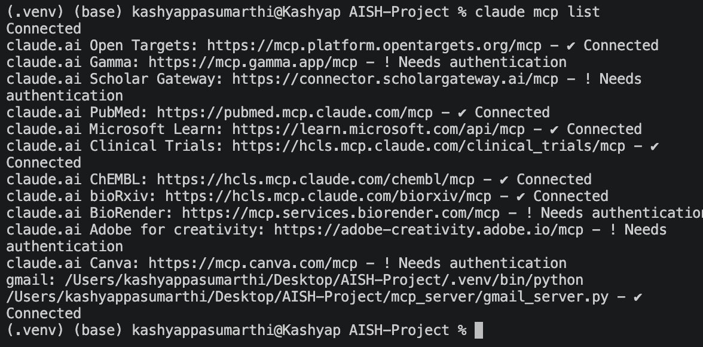
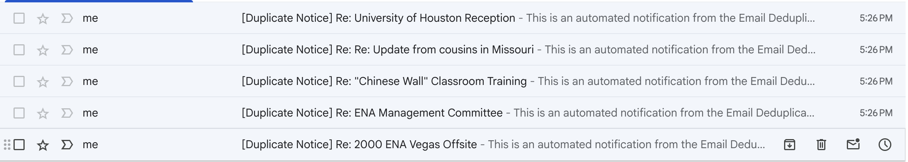
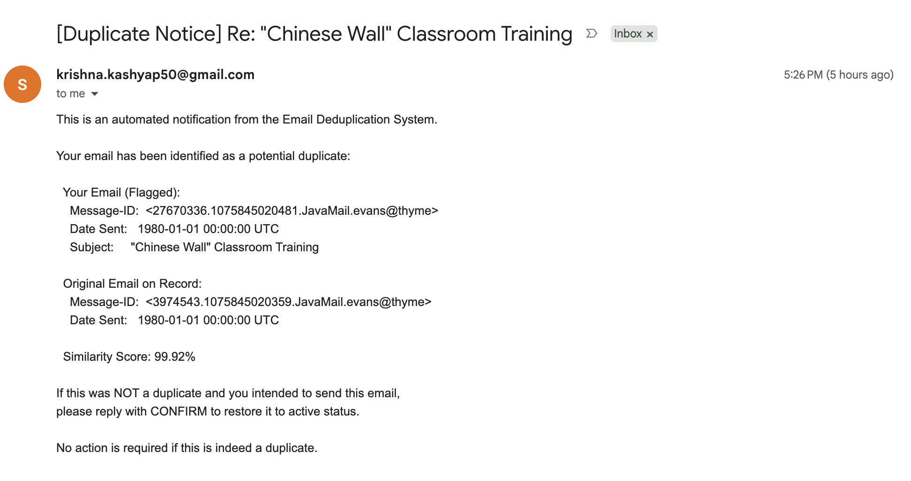

# AI Tool Usage Documentation

## Tool Used

- **Tool:** Claude Code (CLI)
- **Model:** Claude Opus 5.5 (`claude-opus-5-5`), via Claude Code v2.1.177

---

## Prompting Strategy

I didn't dump the whole PDF on Claude. Instead, I fed the prompt specification once for context, but built the actual pipeline in seven small, distinct milestones:

1. Exploring the maildir tree and discovering files
2. Writing field extraction rules and handling dirty header edge cases
3. Database design, normalization, and sample SQL queries
4. Duplicate candidate blocking and fuzzy matching
5. Generating offline draft `.eml` files
6. Setting up the custom Gmail MCP server and test sending
7. Refactoring module boundaries and running baseline regression tests

Before letting Claude jump straight into code, I asked "what are the trade-offs?" or push back whenever an initial suggestion felt over-complicated or risked slowing down the run. Pushing back early on duplicate candidate clustering and date parsing edge cases saved significant debugging and rework later.

---

### Example Prompts

**1. Setting strict boundaries before coding**
> "let's look at the maildir directory first before writing any code. walk 2 or 3 employee mailboxes and report what the tree looks like. also, i want clean separation of concerns: keep all pure parsing and dedupe logic 100% free of file I/O or database calls. put all sqlite queries strictly in `db.py` and file writing in `reports.py`. write a test in `tests/test_architecture.py` to fail if any pure module imports sqlite or opens files."

*Why:* If you don't say this right away, Claude will dump SQL queries, file writes, and parsing loops into one giant script. `tests/test_architecture.py` was added during the single-responsibility refactor (commit 8 of 14), and it now keeps those boundaries from eroding.

**2. Finding weird date formats across real files**

> "pick 50 random emails across our mailboxes and print out just their date headers. show me what date patterns exist in the data and flag any weird or nonstandard ones."

*Why:* Looking at real Date headers instead of guessing showed that the data is consistent: every header is standard RFC 2822 with a numeric offset, such as `Tue, 13 Nov 2001 18:25:59 -0800 (PST)`. A full check confirmed that none of the 23,573 headers use 12-hour AM/PM times or bare timezone names. So the AM/PM and timezone-abbreviation handling was built to meet the assignment's edge-case requirement, and tested with deliberately malformed inputs (Case 1), not because the data needed it.

**3. Fixing the silent AM/PM time drop**

> "i noticed standard python parsedate drops AM/PM and turns '4:39 PM' into 04:39 in the morning messing up timestamps. let us parse rfc 2822 first, but if that fails or drops the PM fall back to dateutil in strict mode."

*Why:* Breaking the problem down meant first fixing the 12-hour clock bug without overcomplicating the prompt.

**4. Stopping an $O(N^2)$ slowdown before it started**

*(I initially drafted a prompt to compare candidate emails directly with RapidFuzz, but before running it, I asked Claude: "If I run pairwise fuzzy matching across all 23,000 emails, how bad is the scaling and how can we optimize the prompt strategy?" Claude pointed out that an unconstrained pairwise scan means about 243 million comparisons. Measured on this data, that takes several minutes even with rapidfuzz's score cutoff (about 45 minutes without it). It suggested grouping candidates by shared attributes first. I used that feedback to refine my prompt:)*

> "doing pairwise fuzzy matching across 23k emails is going to take forever. let's block candidates first: only compare emails that share the exact same `from_address` and normalized subject (strip out Re: and Fwd: prefixes). then only run rapidfuzz on the author's own body text inside each block."

*Why:* Comparing every email against every other email grows quadratically, $O(N^2)$. Grouping by sender and clean subject first reduced the candidate space dramatically, bringing the entire deduplication run down to roughly 2 seconds.

**5. Pushing back on AI over-engineering**
> "the assignment says two emails are duplicates if body similarity is >= 90%. dont add extra rules like comparing forwarded text or thread history. if someone forwards an email with an empty body and it matches another empty body keep it flagged as the spec asks. we will document that tradeoff in the README under known limitations."

*Why:* Claude Code kept trying to be "clever" by adding extra heuristics for pure forwards. I reined it back in to follow the rubric literally, and prompted it to document the edge case instead.

**6. Keeping credentials safe during MCP setup**
> "never hardcode credentials or put them in `mcp_config.json`. load them from `.env` with python-dotenv and set file permissions to 0600. in the mcp server, make sure SMTP uses `ssl.create_default_context()` on port 465."

*Why:* Most LLM examples leave `ssl` contexts unverified or dump raw passwords into JSON configs. Prompting for `.env` and `ssl.create_default_context()` kept credentials out of Git and secured the transport.

**7. Setting the working rules for the whole project**
> "We will build this step by step following clean design principles. Propose one design decision at a time with your rationale, then pause and wait for my approval before moving on"

*Why:* This turned the project into a series of small, reviewable steps. Before writing code, Claude inspected the data and offered options with a recommendation, then waited for my decision. Every design choice was explicit and recorded in a commit.

**8. Refactoring safely**
> "Refactor the codes and modules such that the whole code modules follow KISS Principle (design principle) and make sure it passes Regression tests."

*Why:* Asking for regression safety made Claude snapshot the real outputs before refactoring: the duplicates report, error log, stats, a hash of every draft and a hash of every database row. Afterwards it proved they were byte-identical, which is stronger evidence than the unit tests passing.

**9. Auditing the design**
> "I want every class and functionality in the codebase to follow Single Responsible Princple. I want to make sure that the code is extensible so that if a new functionality is added in future, I can do that without modifying the code much. If not following the SRP princple, Please refactor the code to make it follow Design Principles"

*Why:* Asking for an audit against the principle, before any refactoring, gave an honest assessment first. The classes were fine, but SQL was spread over three modules and output files were written from three places. That led to the final layout, where `db.py` is the only module that runs SQL and `reports.py` the only one that writes files, with `tests/test_architecture.py` enforcing it.

---

## Iterations & Debugging

### Case 1: Dates parsing silently wrong without throwing errors
- **What went wrong:** 
  Standard library tools silently corrupted timestamps without raising exceptions:
  - `Monday, May 14, 2001 4:39 PM CDT`: Python's `email.utils.parsedate_to_datetime` silently ignored the `PM` indicator, parsing the time as `04:39` instead of `16:39 CDT` (`21:39 UTC`).
  - Unknown or non-standard timezone markers were prone to being silently skipped or incorrectly defaulted to UTC.
- **How it was discovered:** 
  I had Claude inspect 50 random emails across our mailboxes first (**Prompt 2**). That check showed our actual corpus headers were clean RFC 2822 timestamps. However, the assignment requires handling timezone abbreviations (PST, EST, CDT, etc.) and offset formats, and handling malformed headers gracefully. To verify our parser met the rubric, I had Claude write adversarial unit tests with dirty timestamps, and the 12-hour clock test failed immediately on the `PM` drop.
- **Refining the prompt:** 
  I gave Claude a targeted instruction (**Prompt 3**): *"i noticed standard python parsedate drops AM/PM and turns '4:39 PM' into 04:39 in the morning messing up timestamps. let us parse rfc 2822 first, but if that fails or drops the PM fall back to dateutil in strict mode."*
- **Fix:** 
  Claude built a two-pass parser based on this directive:
  1. Complete RFC 2822 timestamps go directly to the standard parser.
  2. Every other layout is routed to `dateutil` in strict (non-fuzzy) mode, preserving the correct 24-hour conversion from `AM`/`PM` strings.
  3. `dateutil` parses each date twice with two different default dates. If the results differ, the header is missing a year, month or day (e.g. `May 2001`), and it is logged to `error_log.txt` as incomplete instead of being filled in from today's date.
  4. Unrecognized timezone strings are rejected and logged to `error_log.txt` rather than guessed.
  5. Added regression assertions to `tests/test_parser.py` to ensure future refactors never reintroduce the silent time-drop bug.


### Case 2: False positives caused by quoted thread history
- **Issue:** Example 4 asked for the fuzzy ratio on the author's own body. Before implementing it, Claude pointed out a catch: about 900 pure forwards have an empty body, and any two of them from the same sender with the same subject would match at 100%. It recommended comparing the full text (body + quotes + forwarded blocks) instead, and I approved that. When I audited flagged emails in the 90–92% similarity range, the full-text comparison turned out to have the opposite problem: different replies were flagged as duplicates only because they quoted the same long message. Examples: two replies on the `smu-betas` mailing list quoting the same long post, and a `Re: testing` pair where the replies themselves differed.
- **How I prompted the fix:** I highlighted the two conflicting message IDs and prompted Claude: *"These two emails are talking about totally different things, but both quoted the same forwarded thread. Why are they flagged? Rewrite body.py to separate the author's own text from forwarded and quoted lines, and only run the fuzzy ratio against the author's actual body."*
- **Fix:** Claude first pointed out that no rewrite was needed. `body.py` already separated `body` from `forwarded_content` (anchored on Outlook/Notes markers) and `quoted_content` (lines starting with `>`), which was built in step 2. The real fix was to the **duplicate rule**.
  - **First change:** Claude measured the problem (264 flagged pairs whose own text was less than 90% similar) and offered two options: require both the full text and the own body to match, or keep the full-text rule. I chose **both must match**. That kept the protection against empty-body forwards while stopping the quoted-thread matches. Flagged emails fell from 10,726 to 10,610, because some of those emails correctly matched a different original instead.
  - **Final change:** I then asked for the assignment's definition to be followed literally (example 5), which is what example 4 had also described: the rule now compares `body` only. The side effect Claude had warned about (empty-body forwards always match) is documented under Known Limitations in the README.

### Case 3: MCP SDK v2.3 broke FastMCP imports
- **Issue:** Before writing the Gmail server, Claude ran a short probe script to check the MCP API. Its line `from mcp.server.fastmcp import FastMCP` failed with a `ModuleNotFoundError` because the environment had the newer `mcp` SDK v2.3 installed, where `FastMCP` had been restructured into `MCPServer`. Furthermore, unexpected errors just returned a generic `"Error executing tool send_email"`. Claude's first test of the server, a request with a disallowed `Bcc` header, came back with no reason at all instead of "header not allowed: Bcc". Left unfixed, that would also have hidden failures such as a rejected Gmail login.
- **How I prompted the fix:** Instead of letting Claude guess the API, I prompted: *"Don't guess imports. Run a quick python snippet to inspect the installed mcp package signatures, and re-raise expected failures as ToolError so the real error message reaches the pipeline."*
- **Fix:** Claude wrote the server with `MCPServer` and wrapped authentication and network calls in explicit `ToolError` exceptions. If an App Password is wrong or a recipient is rejected, the actual failure reason is preserved and recorded in `output/send_log.csv`.

### Case 4: An extra line in the live template
- **Issue:** The first live notices had a redirect note (`[Test delivery: intended for …]`) added above the template body, so they no longer matched the assignment's template exactly.
- **How I prompted the fix:** I prompted Claude: *"The body must match the template in section 4.2 character for character. Move the safety redirect note out of the body and put it into an X-Original-To header."*
- **Fix:** Claude moved the intended recipient into the `X-Original-To` header, so the body matches the template exactly.
- **Header injection** was not part of this bug. The MCP server rejected line breaks in header values and subjects from the start, with plain `\r`/`\n` checks rather than regex. A related problem surfaced later in the parser: an encoded subject could decode to text containing a line break, which made the notice builder fail. The fix turns line breaks and control characters in decoded headers into spaces.

---

## What I Wrote vs. What AI Wrote

| Module / Area | Who did what |
|---|---|
| `enron_pipeline/discovery.py` | Claude generated the tree walk; I prompted it to add specific mailbox filtering and `.DS_Store` skips. |
| `enron_pipeline/parser.py` & `body.py` | **Claude** wrote both modules and their tests: MIME decoding, date parsing, body/forwarded/quoted splitting and heading detection. It also wrote the regex fallback for malformed address lists, after finding that Python 3.13+'s `getaddresses` drops a whole list if one entry is malformed, and the edge-case date tests. **I** chose tests at every step, splitting the body by marker type, the filtered heading rules, and following the assignment for empty subjects. How the date-parsing approach evolved is described in Case 1. |
| `enron_pipeline/db.py` & `schema.sql` | **Claude** designed and wrote the normalized schema (`addresses` + `email_recipients` linked by foreign keys), the SQLite loader and `schema.sql`, which is applied with `CREATE … IF NOT EXISTS` (there are no migrations). **I** chose between its options (a shared addresses table, and keeping existing data on re-runs) and I decided to use `from_address` column and index. |
| `enron_pipeline/dedupe.py` | I formulated the candidate blocking strategy on `(from_address, clean_subject)` to avoid $O(N^2)$ slowdowns; Claude implemented the RapidFuzz scoring loop. |
| `mcp_server/gmail_server.py` | **Claude** wrote the server, including the header-injection guards (rejecting line breaks in headers and subjects, and allowing only `References`, `In-Reply-To`, `Reply-To` and `X-*` headers), which were there from the start (see Case 4). **I** prompted it to enforce verified TLS contexts (example 6). When my first live send failed in the terminal with `SMTPServerDisconnected`, I pasted the error and asked for the reason. Claude traced it to my regular Google password being used instead of an App Password, and I then turned on 2-Step Verification and set up the Google App Password myself. |
| `sample_queries.sql` | I specified the query requirements and prompt-guided Claude to write the analytical queries, then I verified them against SQLite CLI. |
| Verification & Live Testing | I configured `.env`, audited offline `.eml` drafts, triggered live send flags, and confirmed delivery in Gmail. |

**Rough division of labor:** ~20% human engineering direction, architecture constraints, edge-case troubleshooting, and targeted prompt instructions; ~80% AI boilerplate, test scaffolding, and rapid refactoring.

---

## MCP Integration

### 1. Server Choice: Custom Python Server vs. Node.js

I had Claude build a custom Python MCP server in `mcp_server/gmail_server.py` using the official `mcp` SDK. I considered existing Node servers like `@gongrzhe/server-gmail-autoauth-mcp`, but chose a custom one because:

- **No OAuth complexity:** It signs in via Gmail SMTP using an isolated 16-character App Password. No need to create a Google Cloud Project, verify an OAuth consent screen, or juggle refresh tokens.
- **Custom headers:** The assignment requires passing a `References` header and our `X-Original-To` tracking header. The open-source GongRzhe server's `send_email` has no general headers parameter for setting them.
- **Single language:** The whole repository stays 100% Python without requiring Node/npm.

The server exposes one tool:
```python
send_email(to: list[str], subject: str, body: str,
           cc: list[str] | None = None, headers: dict[str, str] | None = None) -> str
```

### 2. Step-by-Step Setup

1. **Install dependencies:**
   ```bash
   pip install -r requirements.txt
   ```
2. **Generate an App Password:**
   - In your Google Account, enable **2-Step Verification**.
   - Go to <https://myaccount.google.com/apppasswords> and generate a 16-character App Password.
3. **Configure credentials:**
   ```bash
   cp .env.example .env && chmod 600 .env
   cp mcp_config.json.example mcp_config.json
   ```
   Add your Gmail address and App Password into `.env`.
4. **Register with Claude Code:**
   ```bash
   claude mcp add gmail --scope local -- "$PWD/.venv/bin/python" "$PWD/mcp_server/gmail_server.py"
   claude mcp list   # Should show: gmail ... ✔ Connected
   ```

**Result on my machine.** `claude mcp list` shows the `gmail` server connected (last entry). The other entries are unrelated connectors in my Claude account.



### 3. How Claude Uses the MCP Tool

When testing direct tool execution, I prompted Claude Code:

> "hey claude, let's test sending directly via mcp. take the draft email in `output/replies/9684679.1075854459702.JavaMail.evans@thyme.eml` and call the `send_email` tool. send it to `krishna.kashyap50@gmail.com`. make sure you keep the References header and put the flagged sender into `X-Original-To`."

Claude Code first read that draft, then called the registered MCP tool `mcp__gmail__send_email` (server `gmail`, tool `send_email`). I approved the call when Claude Code asked. These are the actual arguments:
```json
{
  "tool": "mcp__gmail__send_email",
  "arguments": {
    "to": ["krishna.kashyap50@gmail.com"],
    "subject": "[Duplicate Notice] Re: ENA 2000 Offsite",
    "headers": {
      "References": "<9684679.1075854459702.JavaMail.evans@thyme>",
      "X-Original-To": "david.delainey@enron.com"
    },
    "body": "This is an automated notification from the Email Deduplication System.\n\nYour email has been identified as a potential duplicate:\n\n  Your Email (Flagged):\n    Message-ID:  <9684679.1075854459702.JavaMail.evans@thyme>\n    Date Sent:   1980-01-01 00:00:00 UTC\n    Subject:     ENA 2000 Offsite\n\n  Original Email on Record:\n    Message-ID:  <11039522.1075848306657.JavaMail.evans@thyme>\n    Date Sent:   1980-01-01 00:00:00 UTC\n\n  Similarity Score: 100.00%\n\nIf this was NOT a duplicate and you intended to send this email,\nplease reply with CONFIRM to restore it to active status.\n\nNo action is required if this is indeed a duplicate.\n"
  }
}
```

The actual tool response:
```json
{"result": "Sent to krishna.kashyap50@gmail.com (Message-ID: <179340717966.16211.11837205836923965156@gmail.com>)"}
```

The email arrived in my inbox. This was an interactive test of the tool from Claude Code, outside the pipeline, so it isn't recorded in `output/send_log.csv` or in the database's `notification_sent` column. Those record only the pipeline's own `--send-live` runs, shown below.

### 4. Issues Encountered & Fixes

| Issue | Cause | Fix |
|---|---|---|
| `ModuleNotFoundError: mcp.server.fastmcp` | SDK v2.3 renamed `FastMCP` to `MCPServer` | Prompted Claude to inspect the installed package and import `MCPServer` directly. |
| Generic error messages | SDK hides uncaught exception details | Prompted Claude to catch SMTP exceptions and re-raise them as `ToolError`. |
| SMTP authentication failed | Regular Google password used instead of App Password | Enabled 2FA and created a 16-character App Password. |
| Insecure TLS defaults | `smtplib.SMTP_SSL` didn't verify certificates by default | Prompted Claude to add `ssl.create_default_context()` on port 465. |
| Notices must not reach real people | The template addresses each notice to the original Enron sender. Sending thousands of notices to real addresses would be spam, and the assignment says to send to your own Gmail. No email to an Enron address was ever attempted. | Live sends go to the test inbox (`GMAIL_ADDRESS` by default, or `--test-recipient`). The real address is kept in `X-Original-To`, and `--limit` caps each run (default 5). |

### 5. Live Delivery Evidence

Successful deliveries logged to [`output/send_log.csv`](output/send_log.csv) during live runs. The first row came from `python main.py notify --send-live --limit 1`, and the other five from a run with `--limit 5`:

```csv
timestamp,recipient,subject,status,error,intended_recipient,duplicate_message_id
2026-10-30T04:55:00+00:00,krishna.kashyap50@gmail.com,[Duplicate Notice] Re: ENA 2000 Offsite,sent,,david.delainey@enron.com,<9684679.1075854459702.JavaMail.evans@thyme>
2026-10-30T21:25:59+00:00,krishna.kashyap50@gmail.com,[Duplicate Notice] Re: 2000 ENA Vegas Offsite,sent,,kay.chapman@enron.com,<19227899.1075854457455.JavaMail.evans@thyme>
2026-10-30T21:26:02+00:00,krishna.kashyap50@gmail.com,[Duplicate Notice] Re: ENA Management Committee,sent,,kay.chapman@enron.com,<10662996.1075854453516.JavaMail.evans@thyme>
2026-10-30T21:26:04+00:00,krishna.kashyap50@gmail.com,"[Duplicate Notice] Re: ""Chinese Wall"" Classroom Training",sent,,janette.elbertson@enron.com,<27670336.1075845020481.JavaMail.evans@thyme>
2026-10-30T21:26:06+00:00,krishna.kashyap50@gmail.com,[Duplicate Notice] Re: Re: Update from cousins in Missouri,sent,,tori.wells@enron.com,<11008164.1075840281513.JavaMail.evans@thyme>
2026-10-30T21:26:09+00:00,krishna.kashyap50@gmail.com,[Duplicate Notice] Re: University of Houston Reception,sent,,rosalee.fleming@enron.com,<23598633.1075840230833.JavaMail.evans@thyme>
```

**Screenshots from my Gmail inbox.** The five notices from the `--limit 5` run, received at 5:26 PM US Eastern (21:26 UTC, matching the log above):



One of them opened. The body matches the section 4.2 template exactly, and the values match the database for `<27670336.1075845020481.JavaMail.evans@thyme>`: original `<3974543.1075845020359.JavaMail.evans@thyme>`, similarity 99.92%. Both dates are `1980-01-01`, the placeholder date the Enron source files themselves contain for these emails.



Database state verification confirms notification state persisted:
```bash
sqlite3 enron.db "SELECT message_id, notification_sent, notification_date FROM emails WHERE notification_sent = 1"
```

---

## Lessons Learned

### What worked well
- **Building in small, approved steps.** Splitting the work into seven milestones, with Claude proposing one design decision at a time and waiting for my approval (example 7), meant every choice was explicit and recorded in a commit.
- **Asking for tests at every step.** Asking to write test cases and I manually verifying few tests and asking claude to verify each module with the tests is what made the first parser test catch the silent `4:39 PM` misread before any real data depended on it (Case 1).
- **Proving refactors safe with real outputs.** For the KISS refactor (example 8), Claude snapshotted the report, error log, stats, every draft and every database row, and then showed they were byte-identical afterwards. That's stronger evidence than "the tests pass".
- **Auditing before refactoring.** Asking for a single-responsibility audit first (example 9) found SQL spread across three modules and output files written from three places. The result is a layout where `db.py` alone runs SQL and `reports.py` alone writes files, enforced by `tests/test_architecture.py`.
- **Asking about scaling before running anything.** Questioning the pairwise approach (example 4) led to candidate blocking by sender and normalized subject, which brought the deduplication run down to roughly 2 seconds.
- **Inspecting the installed package instead of trusting memory.** Reading the installed MCP SDK's signatures resolved the `FastMCP` → `MCPServer` rename and the hidden error messages (Case 3).

### What was harder than expected
- **Silent failures.** Neither date bug raised an error. `parsedate_to_datetime` dropped `PM` without complaint, and unknown or non-standard timezone markers were silently skipped or treated as UTC (Case 1). Only targeted tests with deliberately malformed timestamps exposed them.
- **Plausible-looking duplicates that were wrong.** Comparing full text flagged different replies that quoted the same long message (Case 2). It took an audit of the 90–92% band to see it, and the rule changed twice: first both texts had to match (10,726 → 10,610 flagged), then it went back to body-only as the assignment defines it.
- **Keeping the AI to the specification.** Claude kept adding heuristics for pure forwards. I had to hold it to the literal ">= 90% body similarity" rule and document the trade-off in the README instead (example 5, Case 2).
- **Matching the template exactly.** The first live notices carried an extra redirect line in the body (Case 4). Moving it into an `X-Original-To` header kept the body identical to section 4.2. Later, an encoded subject containing a line break broke the notice builder.
- **Getting live sending to work.** Gmail rejected the regular account password; it only worked after enabling 2FA and creating an App Password. SMTP also needed an explicitly verified TLS context (Issues table). After that, all six pipeline sends and the interactive Claude Code send arrived (MCP sections 3 and 5).
